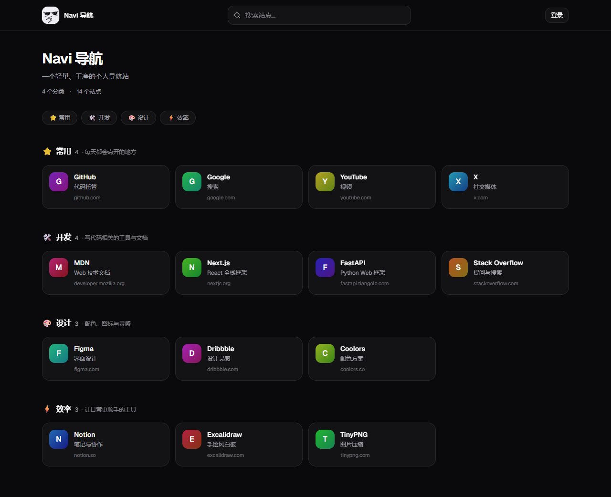

<div align="center">
  
  <h1>Navi 导航站</h1>
  <p>一个轻量、干净的个人导航站，Next.js 全栈实现。</p>
  <p><em>A lightweight, self-hosted navigation site built with Next.js and PostgreSQL.</em></p>

  <p>
    
    
    <a href="LICENSE"></a>
  </p>
</div>



## 功能

- **单页导航**：分类锚点、关键词搜索、点击计数
- **后台管理**：分类与站点的增删改、排序、点击量统计
- **站点设置**：站点名称、ICP 备案号、公安备案号，保存在数据库
- **自动深浅色**：按所在地民用暮光（天亮/天黑）切换，首屏无闪烁
- **实时同步**：后台保存后，已打开的前台页面自动更新，无需刷新
- **唯一个性化图标**：每张卡片按站点 ID 生成不同色相
- **订阅与 SEO**：`/sitemap.xml`、`/rss.xml`、`/atom.xml`、`/manifest.webmanifest`、`/robots.txt`
- **安全**：httpOnly Cookie + JWT，首次启动引导创建管理员

## 技术栈

- **框架**：Next.js 16（App Router / Route Handlers）+ React 19
- **样式**：Tailwind CSS 4
- **数据库**：PostgreSQL + [`pg`](https://node-postgres.com/)
- **鉴权**：JWT（`jose`）+ bcryptjs
- **实时更新**：PostgreSQL `LISTEN/NOTIFY` + SSE

## 快速开始

环境要求：Node.js 20.9+、pnpm、PostgreSQL。

```bash
git clone <your-repo-url> navi
cd navi
cp .env.example .env
pnpm install
pnpm dev
```

打开 http://localhost:3000 。

首次访问会跳转到 `/setup`，创建的第一个账号就是管理员。可以勾选写入一组示例分类和站点。

### 环境变量

复制 `.env.example` 后按需修改：

| 变量 | 说明 |
| --- | --- |
| `DATABASE_URL` | 必填，PostgreSQL 连接串；兼容旧 `postgresql+psycopg://` 前缀 |
| `JWT_SECRET_KEY` | 必填，至少 16 字符，生产环境务必换成随机值 |
| `JWT_EXPIRE_MINUTES` | 登录有效期（分钟），默认 10080 |
| `COOKIE_NAME` | 登录 Cookie 名，默认 `navi_token` |
| `COOKIE_SECURE` | HTTPS 部署时设为 `true` |
| `COOKIE_SAMESITE` | `lax` / `strict` / `none`，默认 `lax` |
| `SITE_NAME` / `SITE_DESCRIPTION` | 站点名称/描述默认值，数据库设置优先 |
| `NEXT_PUBLIC_SITE_URL` | 部署域名，用于 sitemap / feed 的绝对地址 |
| `NEXT_PUBLIC_SITE_LATITUDE` / `NEXT_PUBLIC_SITE_LONGITUDE` | 主题切换用的经纬度，默认上海 |

生成 JWT 密钥：

```bash
node -e "console.log(require('crypto').randomBytes(32).toString('hex'))"
```

数据库表会在首次请求时自动创建；已有旧库会自动补 `site_settings.site_name` 列，不需要手动迁移。

## 常用命令

| 命令 | 说明 |
| --- | --- |
| `pnpm dev` | 启动开发服务器，自动清空 `.next` 并打开页面 |
| `pnpm dev:fast` | 原始 `next dev`，不清缓存、不自动开页 |
| `pnpm build` | 生产构建 |
| `pnpm start` | 启动生产服务器 |
| `pnpm lint` | ESLint |

`pnpm dev` 支持两个环境变量：`NAVI_KEEP_CACHE=1` 保留 `.next`，`NAVI_NO_OPEN=1` 不自动打开浏览器。

## 项目结构

```text
.
├─ src/
│  ├─ app/                    # 页面 + API Route Handlers
│  │  ├─ api/                 # 原生 Next.js 后端
│  │  ├─ admin/               # 管理后台
│  │  ├─ login/ setup/        # 登录与首次引导
│  │  ├─ sitemap.ts
│  │  ├─ robots.ts
│  │  ├─ manifest.ts
│  │  ├─ rss.xml/route.ts
│  │  └─ atom.xml/route.ts
│  ├─ components/             # UI、站点头像、卡片
│  └─ lib/                    # 数据库、鉴权、数据查询、工具
├─ public/                    # 头像、图标等静态资源
├─ docs/                      # README 预览图
├─ scripts/dev.mjs            # 开发启动器
├─ .env.example
└─ package.json
```

## 部署

```bash
pnpm build
pnpm start
```

生产环境建议：

- 用 Nginx / Caddy 把域名反向代理到 Next.js 的 3000 端口
- 设置 `NEXT_PUBLIC_SITE_URL=https://your-domain.com`
- 设置 `COOKIE_SECURE=true`
- 数据库保持可访问；SSE 使用 PostgreSQL `NOTIFY`，单实例或多实例都能实时同步

## License

[MIT](LICENSE)
